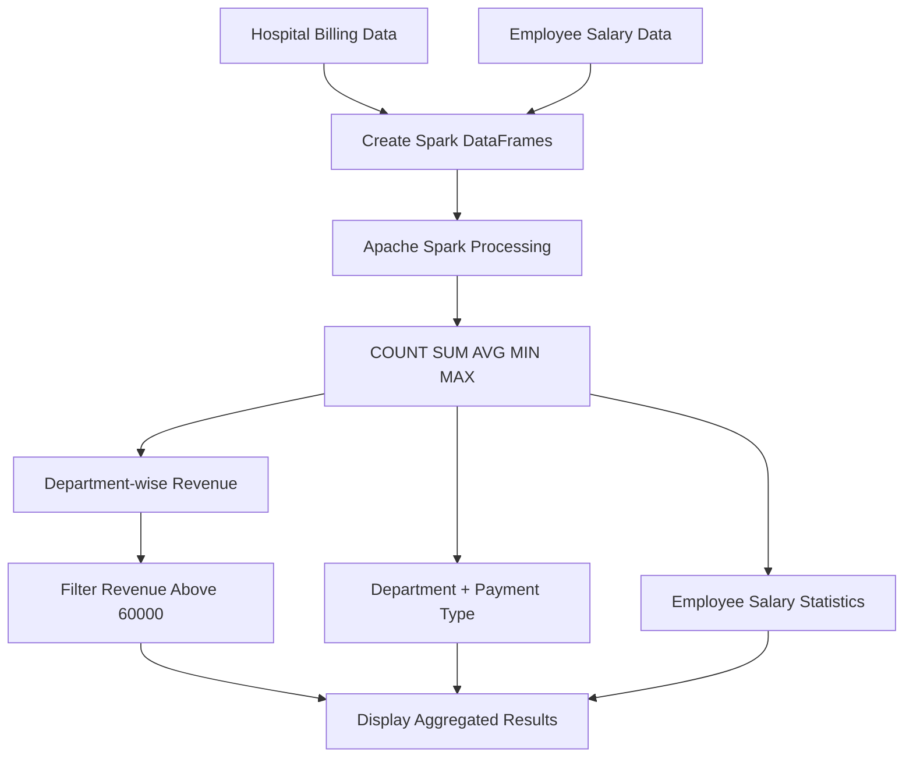

# 🏥 Hospital Department Revenue Aggregation

<p align="center">
  <b>Day 16 | Scala + Apache Spark Practice Project</b>
</p>

<p align="center">
  
  
  
  
</p>

## 📌 Project Overview

This project uses **Scala and Apache Spark DataFrames** to analyze hospital billing records and employee salary data.

It calculates revenue metrics for each hospital department, compares cash and insurance payments, identifies departments exceeding a revenue threshold, and summarizes employee salaries.

## 🎯 Objectives

- Practice `count()`, `sum()`, `avg()`, `min()`, and `max()`.
- Perform department-wise aggregations.
- Group records by multiple columns.
- Apply HAVING-like filtering after aggregation.
- Calculate department-wise employee salary statistics.

## 🏗️ Architecture Diagram



## 🔄 Project Workflow

1. **Data creation** — Create sample hospital billing and employee salary datasets.
2. **DataFrame conversion** — Convert Scala collections into Spark DataFrames.
3. **Aggregation** — Calculate counts, totals, averages, minimums, and maximums.
4. **Grouping** — Analyze data by department and payment type.
5. **Filtering** — Select departments with revenue greater than ₹60,000.
6. **Output** — Display revenue and salary summaries in tabular format.

## 🛠️ Tech Stack

| Technology | Purpose |
|---|---|
| Scala 2.12.18 | Application programming |
| Apache Spark 3.5.3 | Distributed data processing framework |
| Spark SQL / DataFrames | Aggregation and analysis |
| Java 17 | Runtime environment |
| sbt 1.12.15 | Build and dependency management |

## 📊 Key Results

### Overall Hospital Revenue

| Metric | Result |
|---|---:|
| Total bills | 12 |
| Total revenue | 259,000 |
| Average bill | 21,583.33 |
| Minimum bill | 8,000 |
| Maximum bill | 40,000 |

### Department-wise Revenue

| Department | Bills | Total Revenue | Average Bill |
|---|---:|---:|---:|
| Orthopedics | 3 | 87,000 | 29,000 |
| Cardiology | 3 | 75,000 | 25,000 |
| Neurology | 3 | 65,000 | 21,666.67 |
| Pediatrics | 3 | 32,000 | 10,666.67 |

### Revenue Threshold Analysis

Departments with revenue **above 60,000**:

- 🥇 Orthopedics — 87,000
- 🥈 Cardiology — 75,000
- 🥉 Neurology — 65,000

### Payment Type Analysis

The project compares the number of bills and revenue generated through **Cash** and **Insurance** payments for every department.

### Employee Salary Analysis

For each department, the program calculates:

- Employee count
- Total salary expenditure
- Average salary
- Minimum salary
- Maximum salary

## 🧠 Spark Concepts Demonstrated

| Concept | Usage |
|---|---|
| `count()` | Count billing records or employees |
| `sum()` | Calculate total revenue and salary expenditure |
| `avg()` | Find average bill amounts and salaries |
| `min()` / `max()` | Identify minimum and maximum values |
| `groupBy()` | Group records by department |
| Multiple-column grouping | Group by department and payment type |
| `filter()` | Apply HAVING-like filtering after aggregation |
| `orderBy()` | Sort departments by revenue |

**Note:** Spark DataFrame filtering after aggregation provides HAVING-like behavior; this project does not use a literal SQL `HAVING` clause.

## 📁 Project Structure

```text
Day-16-Aggregations/
├── src/
│   └── main/
│       └── scala/
│           └── HospitalRevenueAggregation.scala
├── project/
│   └── build.properties
├── .gitignore
├── build.sbt
└── README.md
```

## ▶️ How to Run

### Prerequisites
- Java 17
- Scala 2.12.18
- sbt 1.12.15

### Compile the project

```bash
sbt clean compile
```

### Run the application

```bash
sbt "runMain HospitalRevenueAggregation"
```

The application prints the billing dataset, overall revenue metrics, department-wise revenue, payment-type analysis, threshold-filtered departments, and salary statistics.

## 💡 Key Takeaways

- Learned how to aggregate numerical data using Spark DataFrames.
- Understood grouping by one or multiple columns.
- Practiced filtering aggregated results.
- Applied Spark analytics to a hospital revenue use case.
- Compared revenue performance and salary expenditure across departments.

## 👩‍💻 Author

**Harsha**

*Scala + Apache Spark — 30 Days of Daily Practice*

---

⭐ If you find this project useful, feel free to explore and learn from the code.
